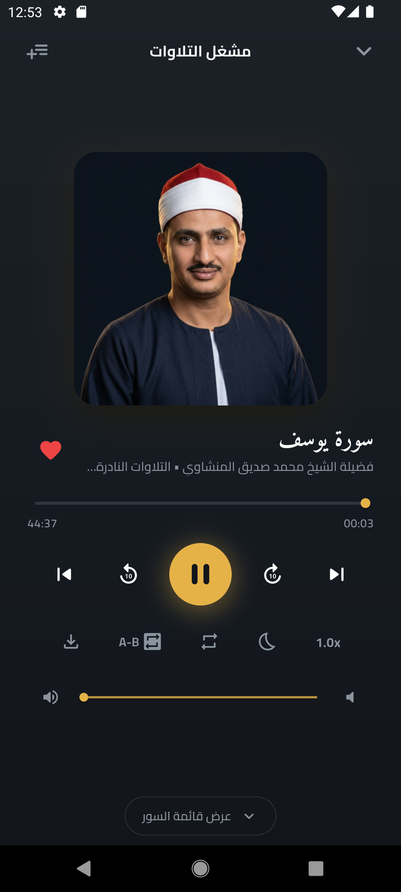

<div align="center">

# جامع تلاوات المنشاوي
### Al-Minshawi Quran Recitations App (v1.2.1)

تطبيق قرآني شامل للتراث الصوتي لفضيلة الشيخ محمد صديق المنشاوي (رحمه الله)  
مبني بـ Flutter وفق معمارية Clean Architecture، مجاني 100% وبدون أي إعلانات.

<br>

<p align="center">
  
</p>

<p align="center">
  <a href="https://a7mdabdoo.github.io/minshawi-recitations-app/">
    
  </a>
  <a href="https://apps.microsoft.com/detail/9npbg9mjslhp">
    
  </a>
  <a href="https://apkpure.com/p/com.minshawi.recitations">
    
  </a>
  <a href="https://github.com/a7mdabdoo/minshawi-recitations-app/releases/download/v1.2.1/al-minshawi-recitations-v1.2.1.apk">
    
  </a>
  <a href="PRIVACY_POLICY.md">
    
  </a>
</p>

</div>

---

## التحميل والتشغيل

يمكنك الآن استخدام التطبيق عبر الويب مباشرة أو تحميله على الكمبيوتر وهاتفك الأندرويد:

| المصدر | نوع التثبيت | رابط الاستخدام / التحميل | الحالة |
| :--- | :--- | :---: | :---: |
| **متجر مايكروسوفت (Microsoft Store)** | التثبيت الرسمي المباشر لنظام ويندوز 10/11 مع تحديثات تلقائية | [](https://apps.microsoft.com/detail/9npbg9mjslhp) | متاح رسمياً على المتجر |
| **مثبت المتجر السريع (Store Installer)** | ملف تنفيذي خفيف ينقر عليه لتثبيت التطبيق فوراً من المتجر | [](https://github.com/a7mdabdoo/minshawi-recitations-app/releases/download/v1.2.1/AlMinshawi-Store-Installer.exe) | تثبيت مباشر بنقرة واحدة |
| **نسخة الويب (Web App)** | تصفح واستماع فوري بدون تحميل | [](https://a7mdabdoo.github.io/minshawi-recitations-app/) | متاح ويعمل |
| **متجر APKPure (Android)** | المتجر الرسمي المعتمد للتطبيق على أندرويد | [](https://apkpure.com/p/com.minshawi.recitations) | متاح على المتجر |
| **مستودع GitHub (Android APK)** | تحميل ملف الـ APK المباشر للأندرويد (v1.2.1) | [](https://github.com/a7mdabdoo/minshawi-recitations-app/releases/download/v1.2.1/al-minshawi-recitations-v1.2.1.apk) | متاح ومباشر |

---

## إهداء وصدقة جارية

> قال رسول الله صلى الله عليه وسلم:  
> «إِذَا مَاتَ الإنْسَانُ انْقَطَعَ عَنْهُ عَمَلُهُ إِلَّا مِنْ ثَلَاثَةٍ: إِلَّا مِنْ صَدَقَةٍ جَارِيَةٍ، أَوْ عِلْمٍ يُنْتَفَعُ بِهِ، أَوْ وَلَدٍ صَالِحٍ يَدْعُو لَهُ» (رواه مسلم)

هذا العمل صَدَقَةٌ جَارِيَةٌ:
- عن روح والدتي رحمها الله تعالى وأسكنها الفردوس الأعلى من الجنة.
- وبراً بوالدي حفظه الله تعالى ورعاه وأطال في عمره على طاعته وصالح عمله.
- وعن نفسي، وعن فضيلة الشيخ محمد صديق المنشاوي، وعن كل من ساهم في نشره أو انتفع بالاستماع إليه.

نسأل الله العلي القدير أن يتقبل هذا العمل خالصاً لوجهه الكريم، وأن يجعله نوراً وأجراً مضاعفاً لا ينقطع.

---

## نبذة عن المشروع

تطبيق **جامع تلاوات المنشاوي** هو منصة قرآنية صوتية مفتوحة المصدر تهدف إلى توفير تجربة استماع راقية وموثوقة للتراث الصوتي الخالد لفضيلة القارئ الشيخ محمد صديق المنشاوي (رحمه الله).

يجمع التطبيق أربعة أقسام رئيسية: المصحف المرتل كاملاً (١١٤ سورة)، والمصحف المجود كاملاً (١١٤ سورة)، والتسجيلات الخارجية النادرة لحفلات عام ١٣٨٧ هـ (٢٦ سورة)، بالإضافة إلى قسم روائع النهاوند الذي يضم ٣٠٣ تسجيلات من أشهر المحافل التاريخية الخالدة مع تبويب خاص للمختارات الذهبية (٢١ محفلاً). يتميز التطبيق بمشغل صوتي عصري ومتقدم، وأدوات متخصصة في حفظ القرآن الكريم ومراجعته، وفحص تلقائي للتحديثات، مع دعم كامل للتشغيل دون اتصال بالإنترنت وخلو تام من الإعلانات أو أدوات التتبع.

<br>

### About The Project (English)

**Al-Minshawi Quran Recitations (v1.2.1)** is a modern, open-source audio streaming and offline playback platform engineered to present the timeless recordings of Sheikh Muhammad Siddiq Al-Minshawi.

The app bundles four comprehensive collections: his complete Murattal recitation (114 Surahs), complete Mujawwad recitation (114 Surahs), rare historic external concert recordings from 1387 AH (26 Surahs), and the Nahawand Masterpieces collection (303 historic recordings alongside a curated 21-track Golden Selection). It provides an elegant audio experience with Quranic memorization tools, offline caching, automatic in-app update checking, and strict zero-advertising and privacy commitments.

---

## لقطات الشاشة / App Screenshots

<div align="center">
  <table>
    <tr>
      <th align="center">الرئيسية (الوضع الليلي)</th>
      <th align="center">الرئيسية (الوضع النهاري)</th>
      <th align="center">مشغل التلاوات</th>
      <th align="center">تكرار الحفظ (A-B)</th>
      <th align="center">قوائم التشغيل</th>
    </tr>
    <tr>
      <td align="center"></td>
      <td align="center"></td>
      <td align="center"></td>
      <td align="center"></td>
      <td align="center"></td>
    </tr>
  </table>
</div>

---

## المميزات الرئيسية

### ١. مكتبة تلاوات شاملة (٤ أقسام رئيسية)
- **المصحف المرتل كاملاً:** ١١٤ سورة نقية برواية حفص عن عاصم.
- **المصحف المجود كاملاً:** ١١٤ سورة من روائع التلاوة المجودة بجودة صوتية عالية.
- **التلاوات النادرة لعام ١٣٨٧ هـ:** ٢٦ سورة من الحفلات والتسجيلات الخارجية النادرة.
- **روائع النهاوند (جديد في v1.1.0):** يضم ٣٠٣ تسجيلات من المحافل التاريخية الخالدة بمقام النهاوند، مع تبويب مستقل للمختارات الذهبية (٢١ محفلاً مختاراً) وعرض تفصيلي لاسم السورة ومكان وتاريخ التسجيل.

### ٢. مشغل صوتي متطور وشريط تحكم مصغر
- **واجهة عصرية متناسقة:** تصميم داكن بلمسات ذهبية يتناغم بدقة مع ألوان التطبيق في الوضعين الداكن والفاتح.
- **إيماءات سحب سلسة:** سحب لأعلى على الشريط المصغر لفتح المشغل الكامل بانتقال ناعم، وسحب لأسفل في المشغل الكامل للرجوع الفوري.
- **تحكم زمني دقيق:** أزرار تقديم وتأخير مخصصة (+10 ثوانٍ و -10 ثوانٍ) لتسهيل متابعة الآيات والتدبر.
- **تشغيل في الخلفية وشاشة القفل:** تكامل كامل مع نظام التشغيل عبر `just_audio` و `audio_service` مع أزرار التحكم في شريط الإشعارات وشاشة القفل.

### ٣. أداة التكرار الذكي لحفظ الآيات (A-B Repeat)
- إمكانية تحديد نقطة بداية (A) ونقطة نهاية (B) بدقة بالغة بالثواني.
- أزرار ضبط دقيق (+1 ثانية و -1 ثانية) لكل نقطة للوصول لبداية الآية ونهايتها بالضبط.
- تكرار تلقائي بعدد محدد أو تكرار لانهائي للمساعدة في تثبيت الحفظ ومراجعة الأحكام.

### ٤. قوائم التشغيل المخصصة والمفضلة المعزولة
- إنشاء وإدارة قوائم تشغيل مخصصة للتلاوات المفضلة وحفظها محلياً عبر Hive.
- إظهار شارة مصدر التلاوة (المصحف المرتل، المصحف المجود، التلاوات النادرة، روائع النهاوند) داخل قوائم التشغيل والتنزيلات للتمييز الفوري بين التسجيلات.
- عزل عداد وقائمة المفضلة لكل قسم بشكل مستقل لسهولة الوصول إلى مفضلة كل مصحف على حدة.
- بحث فوري وسريع يدعم تطبيع الحروف والهمزات العربية لمنع أي فقد في نتائج البحث.

### ٥. الاستماع والتحميل بدون إنترنت (Offline Playback)
- تحميل السور والتلاوات للاستماع أثناء السفر أو في غياب شبكة الإنترنت.
- إدارة ذكية للتحميل تدعم الاستئناف التلقائي والإيقاف المؤقت، مع فحص سلامة الملفات على القرص.

### ٦. مؤقت النوم الذكي (Sleep Timer)
- خيارات زمنية مرنة مع إيقاف تدريجي هادئ للصوت لحماية السمع ومنع انقطاع الصوت المفاجئ.

### ٧. فحص التحديثات التلقائي (In-App Update Checker)
- خدمة خفيفة ومستقلة تتحقق تلقائياً عند بدء التشغيل من توفر إصدار أحدث عبر ملف `version.json` في المستودع الرسمي.
- عرض نافذة تنبيه متناسقة مع هوية التطبيق تتضمن رقم الإصدار الجديد وملاحظات التحديث وزر الانتقال المباشر للتحميل، مع التجاهل الصامت التام في حال عدم توفر اتصال بالإنترنت.

### ٨. واجهة كمبيوتر متجاوبة بالكامل (Windows Desktop UI)
- **تصميم مخصص للشاشات الكبيرة:** قائمة جانبية ثابتة (Sidebar) للتنقل السلس، وشبكة كروت متجاوبة تتوزع تلقائياً لتملأ الشاشة بأناقة.
- **شريط مشغل سفلي عريض (Persistent Player Bar):** تحكم كامل في مستوى الصوت، سرعة التلاوة، مؤقت النوم، التكرار، التقديم والتأخير، وشريط تقدم زمني دقيق.
- **دعم اختصارات لوحة المفاتيح:** زر المسافة (Space) للتشغيل والإيقاف المؤقت، والأسهم للتقديم والتأخير والتحكم في الصوت.

---

## التقنيات والبنية البرمجية

- **إطار العمل:** Flutter (v3.29+)
- **لغة البرمجة:** Dart (v3.7+)
- **النمط المعماري:** Clean Architecture (Data, Domain, Presentation)
- **إدارة الحالة:** BLoC / Cubit مع تحسينات إعادة البناء `buildWhen` لأعلى أداء وسلاسة.
- **قواعد البيانات والتخزين المحلي:** Hive NoSQL لحفظ التفضيلات وقوائم التشغيل ومسارات التنزيل محلياً.
- **محرك الصوتيات:** `just_audio`, `audio_service`, `just_audio_background`
- **التنقل والتوجيه:** `go_router`
- **إدارة الشبكة والتحديثات:** `dio`, `http`, `package_info_plus`, `url_launcher`
- **الخطوط والطباعة:** Amiri للنصوص القرآنية، و Cairo لواجهات المستخدم.

---

## هيكل المجلدات البرمجية

```
lib/
├── core/
│   ├── constants/              # ألوان التطبيق، الروابط، والثيمات
│   ├── di/                     # حقن التبعيات (GetIt service locator)
│   ├── errors/                 # معالجة الأخطاء والاستثناءات
│   ├── network/                # إعدادات عميل Dio
│   ├── router/                 # مسارات التنقل والتوجيه عبر GoRouter
│   ├── services/               # خدمات الصوت، التنزيل، وفحص التحديثات التلقائي
│   ├── settings/               # إعدادات المستخدم وتفضيلات التشغيل
│   ├── theme/                  # تكوين الثيمات (Dark & Light Mode)
│   └── utils/                  # أدوات معالجة النصوص وتنسيق الوقت
├── features/
│   ├── downloads/              # إدارة التنزيلات وعرض السور المحملة
│   ├── favorites/              # المفضلة والتسجيلات المحفوظة
│   ├── player/                 # مشغل الصوت الكامل، المشغل المصغر، مؤقت النوم، وتكرار A-B
│   ├── playlists/              # إدارة قوائم التشغيل المخصصة والبحث
│   └── recitations/            # فهرس السور والمصاحف وروائع النهاوند والصفحة الرئيسية
└── main.dart                   # نقطة انطلاق التطبيق
```

---

## سياسة الخصوصية

التطبيق مجاني 100%، بدون أي إعلانات تجارية أو أدوات تتبع، ولا يجمع أو يشارك أي بيانات شخصية للمستخدمين. للاطلاع على الوثيقة الرسمية لسياسة الخصوصية:
- [وثيقة سياسة الخصوصية الكاملة في المستودع (PRIVACY_POLICY.md)](PRIVACY_POLICY.md)
- [الرابط العام المباشر على GitHub](https://github.com/a7mdabdoo/minshawi-recitations-app/blob/main/PRIVACY_POLICY.md)

---

## التثبيت والتشغيل للمطورين

### المتطلبات الأساسية
- Flutter SDK (الإصدار 3.29.0 أو أحدث)
- Android SDK مع دعم Android 8.0 (API 26) فما فوق
- بيئة تطوير متكاملة (VS Code أو Android Studio)

### خطوات التشغيل

1. **استنساخ المستودع:**
   ```bash
   git clone https://github.com/a7mdabdoo/minshawi-recitations-app.git
   cd minshawi-recitations-app
   ```

2. **تثبيت الحزم البرمجية:**
   ```bash
   flutter pub get
   ```

3. **تشغيل الاختبارات البرمجية:**
   ```bash
   flutter test
   ```

4. **تشغيل التطبيق في بيئة التطوير:**
   ```bash
   flutter run
   ```

5. **بناء حزمة الإنتاج المخففة (Release APK):**
   ```bash
   flutter build apk --release --split-per-abi --obfuscate --split-debug-info=build/app/outputs/symbols
   ```

---

## الترخيص

هذا المشروع متاح بموجب ترخيص [MIT License](LICENSE). جميع التلاوات الصوتية هي تراث إسلامي عام لفضيلة الشيخ محمد صديق المنشاوي (رحمه الله).
